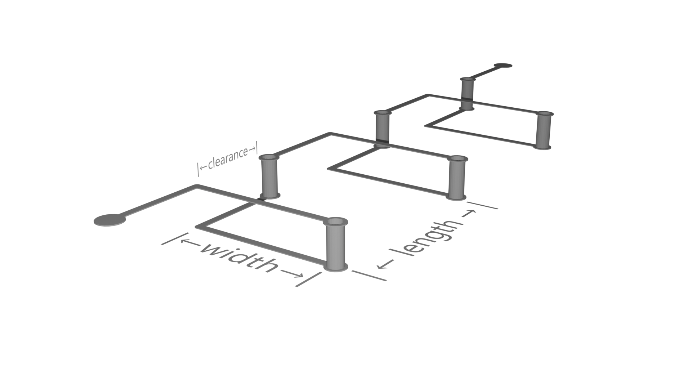

This is a Python-script to generate a KiCad-footprint of a rectangular planar coil for PCB-design.
You can see the coil here:

The height is given as the height of the PCB itself.
For generation of the footprint, the height is not used.
You have to know it, if you want to calculate the inductance of the coil.

For generating the rectangular coil you have to know several parameters:

1. parameters of the coil
    - height
    - lenght of one turn (between two vias, as seen in the image)
    - number of turns
    - trackwidth of the conductor

2. parameters of a via
    - outer diameter
    - drill

3. parameters of a pad
    - outer diameter

The functions you use are documented in docstrings in the script.
Normally, you only have to touch the parameters, unless you want to touch the design.

Also, the script calculates the clearance. It is calculated as following:

$$ clearance = \frac{length - via_{diameter} - trackwidth}{2}$$

You can see it in the image as well.

The footprint is saved in the folder, where you execute the script (probably not the folder, where the script is located).
Please have this in mind.
